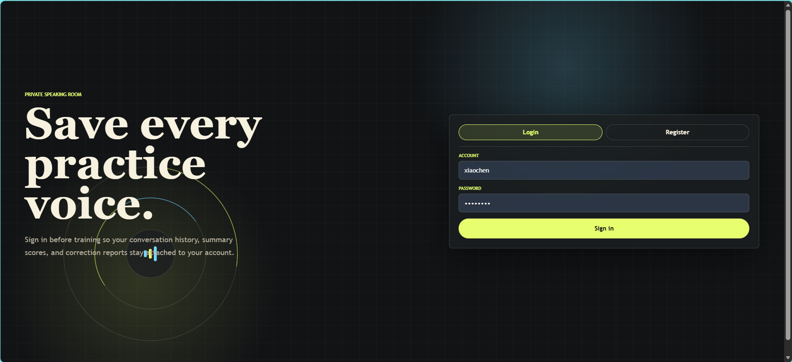
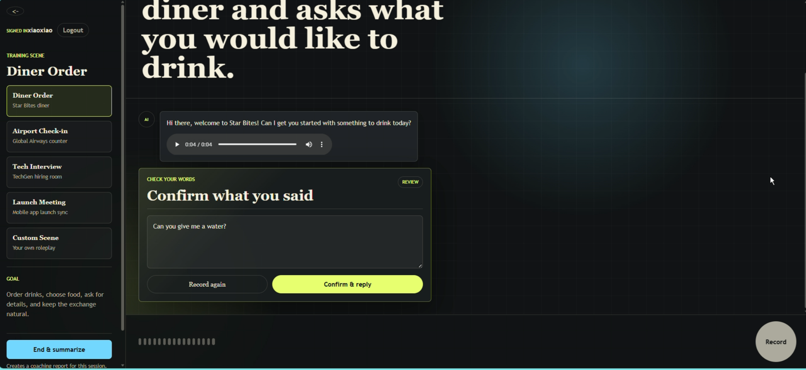
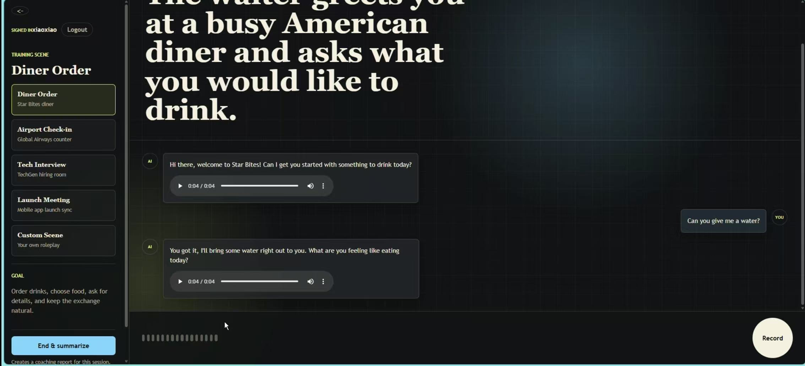
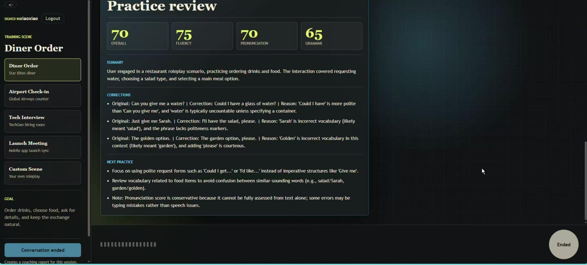
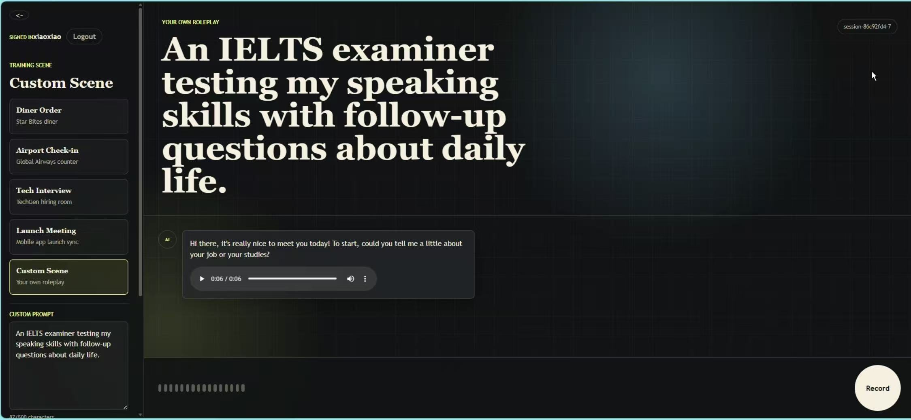
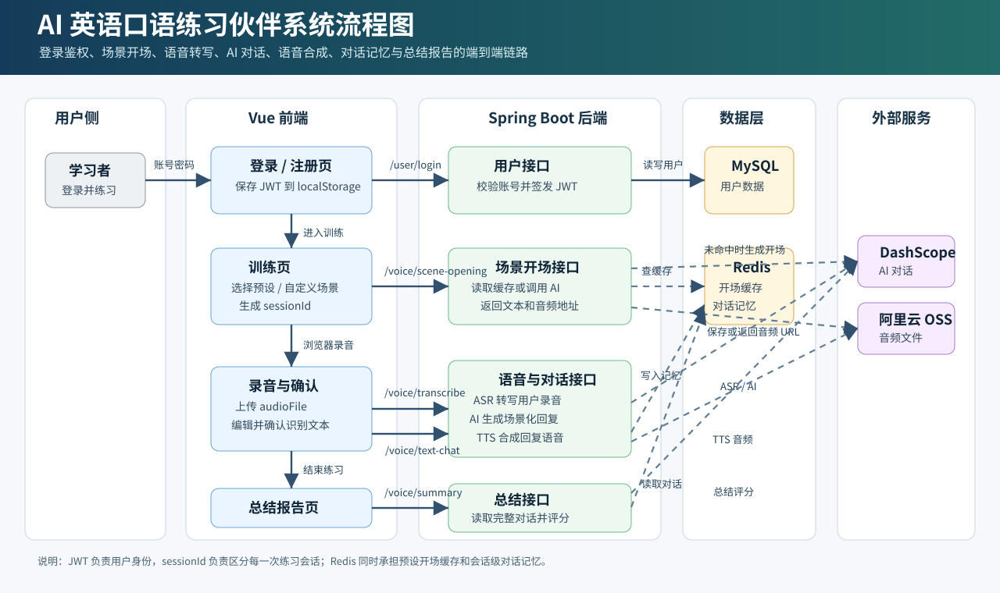

# AI 英语口语练习伙伴

AI 英语口语练习伙伴是一个基于场景的英语口语训练应用。用户可以登录后选择练习场景，通过语音输入完成对话，确认语音识别文本，获得 AI 回复和语音播放，并在练习结束后生成口语表现总结报告。

## 目录

- [核心功能](#核心功能)
- [功能预览](#功能预览)
- [系统流程图](#系统流程图)
- [技术栈](#技术栈)
- [项目结构](#项目结构)
- [核心流程](#核心流程)
- [接口说明](#接口说明)
- [Redis 数据](#redis-数据)
- [环境要求](#环境要求)
- [配置说明](#配置说明)
- [本地启动](#本地启动)
- [常用命令](#常用命令)
- [测试清单](#测试清单)
- [常见问题](#常见问题)
- [部署说明](#部署说明)
- [演示录制建议流程](#演示录制建议流程)

## 核心功能

- 用户注册、登录、退出登录，以及基于 JWT 的接口鉴权。
- 内置口语练习场景，例如餐厅点餐、机场值机、技术面试、发布会沟通等。
- 支持自定义场景，用户可以输入自己的角色扮演情境。
- AI 自动生成场景开场白，预设场景的开场白支持 Redis 缓存。
- 支持浏览器录音、语音转文字、识别文本确认与手动编辑。
- AI 根据场景和上下文生成英文回复，并返回对应的语音播放地址。
- 基于 `sessionId` 在 Redis 中维护每轮练习的对话记忆。
- 练习结束后生成总结报告，包括总分、流利度、发音、语法、纠错建议和后续提升建议。

## 功能预览

截图、演示视频和流程图都放在 `image` 目录。当前 README 使用下面这些文件作为展示素材。

### 演示视频

<video src="image/视频讲解.mp4" controls width="100%"></video>

如果当前 Markdown 查看器不支持内嵌视频，可以直接打开 [视频讲解.mp4](image/视频讲解.mp4)。

### 登录与注册



### 场景选择与 AI 开场


### 语音识别文本确认



### AI 回复与语音播放



### 对话总结报告



### 自定义场景



## 系统流程图



这张图展示了从用户登录、选择场景、获取 AI 开场、录音转写、确认文本、AI 回复、TTS 音频生成，到 Redis 对话记忆和最终总结报告的完整链路。

## 技术栈

### 后端

| 模块 | 技术 |
| --- | --- |
| 语言 | Java 17 |
| 框架 | Spring Boot 3.4.2 |
| 接口 | Spring MVC REST API |
| 鉴权 | JWT + 自定义 `@AuthCheck` AOP |
| 数据库 | MySQL |
| ORM | MyBatis-Plus |
| 缓存与对话记忆 | Redis |
| AI 对话 | Spring AI Alibaba / DashScope |
| ASR / TTS 相关 SDK | Alibaba DashScope SDK |
| 对象存储 | 阿里云 OSS |
| 接口文档 | Knife4j / SpringDoc |

### 前端

| 模块 | 技术 |
| --- | --- |
| 框架 | Vue 3 |
| 构建工具 | Vite 6 |
| HTTP 客户端 | Axios |
| 样式 | 原生 CSS |
| 本地状态 | Vue Composition API + `localStorage` |

## 项目结构

```text
AIEnglishSpeakingPracticeCompanion/
|-- frontend/                         # Vue / Vite 前端项目
|   |-- src/
|   |   |-- components/               # 场景栏、录音器、对话区、总结报告、文本确认组件
|   |   |-- services/                 # API 请求封装与场景定义
|   |   |-- views/                    # 登录页、欢迎页、训练页
|   |   |-- App.vue
|   |   |-- main.js
|   |   `-- styles.css
|   |-- package.json
|   `-- vite.config.js
|-- image/                            # README 截图与演示图片
|-- src/
|   |-- main/
|   |   |-- java/com/cxy/aienglishspeakingpracticecompanion/
|   |   |   |-- aop/                  # JWT 鉴权切面
|   |   |   |-- app/                  # AI、ASR、TTS、OSS 应用服务
|   |   |   |-- common/               # 通用响应结构与返回工具
|   |   |   |-- config/               # Redis、MyBatis、Web 配置
|   |   |   |-- controller/           # 用户与语音接口
|   |   |   |-- manager/              # 存储或第三方集成管理类
|   |   |   |-- mapper/               # MyBatis Mapper 接口
|   |   |   |-- model/                # 实体、DTO、请求与响应对象
|   |   |   |-- service/              # 业务服务
|   |   |   `-- utils/                # JWT 与通用工具
|   |   `-- resources/
|   |       |-- application.yml
|   |       |-- application-local.yml # 本地配置，请勿提交真实密钥
|   |       `-- generator/mapper/     # Mapper XML 文件
|   `-- test/
|-- pom.xml
`-- README.md
```

## 核心流程

### 1. 用户登录

用户在前端登录后，后端校验账号密码并返回 JWT。前端将 token 存入 `localStorage`，后续访问受保护接口时携带：

```http
Authorization: Bearer <token>
```

语音相关接口通过 `@AuthCheck` 进行鉴权。

### 2. 创建练习会话

前端在开始练习时生成 `sessionId`。它和 JWT 的职责不同：

- JWT 用于识别当前请求属于哪个用户。
- `sessionId` 用于识别当前读写的是哪一段对话历史。

同一个登录用户可以通过开始新场景创建多个独立练习会话。

### 3. 场景开场白

用户进入场景后，前端调用：

```http
POST /api/voice/scene-opening
```

如果是预设场景，后端会先检查 Redis 缓存：

```text
scene:opening:{scene}
```

命中缓存时直接返回已生成的 AI 开场文本和音频地址；未命中时调用 AI 生成开场白，再进行语音合成，最后写入缓存并返回给前端。

### 4. 语音转确认文本

用户在浏览器中录音后，前端将音频文件上传到：

```http
POST /api/voice/transcribe
```

后端返回识别文本。前端展示确认面板，用户可以编辑识别结果，也可以重新录音。

### 5. 确认文本并获取 AI 回复

用户确认文本后，前端调用：

```http
POST /api/voice/text-chat
```

后端会把用户文本写入当前 `sessionId` 对应的对话记忆，调用 AI 生成符合场景的回复，再将 AI 回复转换为语音，最后把 AI 消息也写入对话记忆并返回给前端。

### 6. 生成对话总结

用户点击结束练习后，前端调用：

```http
GET /api/voice/summary?sessionId=<sessionId>
```

后端从 Redis 读取完整对话历史，把上下文发送给总结提示词，再解析为 `ConversationSummaryResponse` 返回给前端。

## 接口说明

下面的接口路径都包含后端统一前缀 `/api`。

### 用户接口

#### 注册

```http
POST /api/user/register
Content-Type: application/json
```

请求示例：

```json
{
  "username": "Alex Shaw",
  "userAccount": "alex",
  "password": "12345678",
  "phone": "13800000000",
  "email": "alex@example.com"
}
```

#### 登录

```http
POST /api/user/login
Content-Type: application/json
```

请求示例：

```json
{
  "userAccount": "alex",
  "password": "12345678"
}
```

响应中会包含登录用户信息和 token。前端会保存 token，并在访问受保护接口时自动携带。

#### 退出登录

```http
POST /api/user/logout
Authorization: Bearer <token>
```

### 语音接口

#### 获取场景开场白

```http
POST /api/voice/scene-opening
Authorization: Bearer <token>
Content-Type: application/json
```

预设场景请求示例：

```json
{
  "sessionId": "session-215142d3-example",
  "scene": "diner"
}
```

自定义场景请求示例：

```json
{
  "sessionId": "session-215142d3-example",
  "customScenario": "You are a hotel receptionist helping me check in late at night."
}
```

#### 上传语音并转写

```http
POST /api/voice/transcribe
Authorization: Bearer <token>
Content-Type: multipart/form-data
```

表单字段：

| 字段 | 类型 | 说明 |
| --- | --- | --- |
| `audioFile` | File | 浏览器录制的音频文件 |
| `sessionId` | String | 当前对话会话 ID |

#### 发送确认文本并获取 AI 回复

```http
POST /api/voice/text-chat
Authorization: Bearer <token>
Content-Type: application/json
```

请求示例：

```json
{
  "sessionId": "session-215142d3-example",
  "userText": "I would like an orange juice, please.",
  "scene": "diner"
}
```

#### 获取对话总结

```http
GET /api/voice/summary?sessionId=session-215142d3-example
Authorization: Bearer <token>
```

## Redis 数据

项目使用 Redis 保存登录状态、对话记忆和预设场景开场白缓存。

| Key 模式 | 用途 |
| --- | --- |
| `jwt:token:*` 或鉴权服务中配置的用户 token key | 保存登录 token 状态，用于 JWT 校验和退出登录 |
| `speak:chat:memory:{sessionId}` | 保存当前练习会话的完整对话历史 |
| `scene:opening:{scene}` | 保存预设场景的 AI 开场文本和音频地址 |

`sessionId` 只代表一次练习会话，不等同于用户身份。用户身份仍然由 JWT 决定。

## 环境要求

- JDK 17 或更高版本。
- Maven 3.9 或兼容版本。
- Node.js 18 或更高版本。
- npm。
- MySQL 8 或兼容的 MySQL 数据库。
- Redis 6 或更高版本。
- 阿里云 DashScope API 访问权限。
- 如需上传或访问合成语音文件，需要阿里云 OSS Bucket 和访问密钥。

## 配置说明

后端默认启用 `local` profile：

```yaml
spring:
  profiles:
    active: local
server:
  port: 8080
  servlet:
    context-path: /api
```

本地配置建议写在 `src/main/resources/application-local.yml` 中。不要把真实密钥提交到公开仓库。

常用配置项：

| 配置 | 说明 |
| --- | --- |
| `spring.datasource.url` | MySQL JDBC 地址 |
| `spring.datasource.username` | MySQL 用户名 |
| `spring.datasource.password` | MySQL 密码 |
| `spring.data.redis.host` | Redis 主机 |
| `spring.data.redis.port` | Redis 端口 |
| `spring.data.redis.password` | Redis 密码，没有密码可留空 |
| `spring.ai.dashscope.api-key` | DashScope API Key |
| `aliyun.oss.endpoint` | OSS Endpoint |
| `aliyun.oss.bucketName` | OSS Bucket 名称 |
| `aliyun.oss.region` | OSS 地域 |
| `OSS_ACCESS_KEY_ID` | OSS Access Key ID，建议使用环境变量 |
| `OSS_ACCESS_KEY_SECRET` | OSS Access Key Secret，建议使用环境变量 |

接口文档相关配置位于 `application.yml`。如果 Knife4j 或 Swagger UI 打开后看不到接口，优先检查：

```yaml
springdoc:
  group-configs:
    - packages-to-scan: com.cxy.aienglishspeakingpracticecompanion.controller
```

当前项目的 Controller 包路径应指向 `com.cxy.aienglishspeakingpracticecompanion.controller`。

## 本地启动

### 1. 准备 MySQL

创建数据库：

```sql
CREATE DATABASE ai_english_db DEFAULT CHARACTER SET utf8mb4 COLLATE utf8mb4_unicode_ci;
```

确认 `user` 表结构与当前后端模型匹配。如果使用 MyBatisX 重新生成代码，请检查生成的 entity、mapper、service 和 XML 文件是否写入了正确包路径。

### 2. 启动 Redis

本地启动 Redis 或连接你自己的 Redis 服务。项目默认使用 Redis database `3`，除非在本地配置中覆盖。

### 3. 启动后端

在项目根目录执行：

```bash
mvn spring-boot:run
```

后端服务地址：

```text
http://localhost:8080/api
```

接口文档地址通常为：

```text
http://localhost:8080/api/doc.html
http://localhost:8080/api/swagger-ui.html
```

### 4. 启动前端

进入前端目录：

```bash
cd frontend
npm install
npm run dev
```

如果 Windows PowerShell 阻止执行 `npm` 脚本，可以使用：

```bash
npm.cmd run dev
```

前端服务地址：

```text
http://localhost:5173
```

Vite 会把 `/api` 请求代理到：

```text
http://localhost:8080
```

## 常用命令

### 后端

| 命令 | 说明 |
| --- | --- |
| `mvn spring-boot:run` | 启动 Spring Boot 后端 |
| `mvn test` | 运行后端测试 |
| `mvn clean package` | 构建后端包 |
| `mvn clean package -DskipTests` | 跳过测试并构建后端包 |

### 前端

以下命令在 `frontend/` 目录中执行。

| 命令 | 说明 |
| --- | --- |
| `npm install` | 安装前端依赖 |
| `npm run dev` | 启动 Vite 开发服务 |
| `npm run build` | 构建生产前端资源 |
| `npm run preview` | 预览构建后的前端资源 |

## 测试清单

### 使用 Apifox 测试后端接口

1. 调用 `POST /api/user/register` 注册用户。
2. 调用 `POST /api/user/login` 登录。
3. 复制响应中的 token。
4. 给受保护接口添加 `Authorization: Bearer <token>` 请求头。
5. 使用新的 `sessionId` 调用 `POST /api/voice/scene-opening`。
6. 使用同一个 `sessionId` 调用 `POST /api/voice/transcribe` 上传音频文件。
7. 调用 `POST /api/voice/text-chat` 发送确认后的 `userText`。
8. 调用 `GET /api/voice/summary?sessionId=<sessionId>` 验证总结报告。

### 前端手动测试

1. 打开 `http://localhost:5173`。
2. 注册或登录。
3. 选择一个预设场景。
4. 确认页面展示 AI 开场文本，并可播放开场语音。
5. 录制一段英文回答。
6. 确认语音识别文本只出现一次，并且可以编辑。
7. 点击确认，检查 AI 回复文本和语音是否返回。
8. 滚动对话区，确认录音区域保持在底部，场景标题随内容区滚动。
9. 点击结束并总结，确认总结报告正常展示。
10. 开启新练习，确认系统生成新的 `sessionId`。

### 构建验证

前端：

```bash
cd frontend
npm.cmd run build
```

后端：

```bash
mvn test
```

如果后端测试依赖外部 AI、Redis、MySQL 或 OSS 服务，可以为这些集成提供本地配置，或在测试中使用 mock。

## 常见问题

### 401 Unauthorized

检查以下内容：

- 用户是否已经成功登录。
- 前端是否发送了 `Authorization: Bearer <token>`。
- token 是否已被退出登录逻辑移除。
- 后端 JWT 密钥和 Redis 中的 token 状态是否有效。

### `sessionId` 容易混淆

`sessionId` 表示一次口语练习会话，需要传给场景开场、语音转写、文本对话和总结接口。

JWT 回答“当前用户是谁”，`sessionId` 回答“当前是哪一段对话”。

### 场景开场白生成很慢

预设场景开场白应该通过 `scene:opening:{scene}` 缓存在 Redis 中。如果每次仍然重新生成，检查：

- Redis 是否连接成功。
- 场景 key 是否稳定。
- 缓存中的 JSON 是否能解析为 `VoiceChatResponse`。
- 命中缓存后，后端是否仍然把开场白写入当前会话记忆。

### 语音识别文本重复出现

ASR 结果可能同时包含完整 transcript 和 sentence-level 文本。解析逻辑应优先使用 sentence-level 文本，在句子列表缺失时再回退到完整 transcript。

### AI 回复或 TTS 很慢

可以考虑以下优化：

- 将 ASR 和 AI 回复拆成两个接口，本项目已经采用这种方式。
- 缓存预设场景的开场白和音频。
- 前端展示明确的等待状态。
- 对较长回复考虑流式文本返回或异步 TTS。
- 保持 prompt 简洁，并让场景信息足够明确。

### Maven 无法下载依赖

检查以下内容：

- Maven 本地仓库权限是否正常。
- 当前网络是否可以访问 Maven 仓库。
- 本地 Maven 仓库中是否存在过期的 `.lastUpdated` 文件。
- `settings.xml` 是否配置了可用镜像。

### PowerShell 中 `npm` 被阻止

可以使用：

```bash
npm.cmd run dev
npm.cmd run build
```

也可以根据本机安全策略调整 PowerShell execution policy。

### MyBatisX 提示生成成功但没有文件

检查以下内容：

- 是否选择了正确的数据表。
- module path 是否是当前项目。
- base package 是否指向 `com.cxy.aienglishspeakingpracticecompanion`。
- entity、mapper、service、XML 的输出路径是否已启用。
- 文件是否被生成到了其他模块或 source root。
